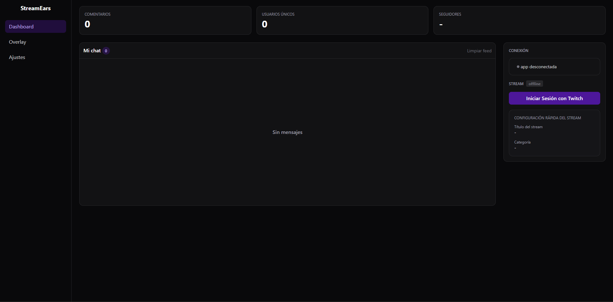

# StreamEars

Herramienta para streamers de Twitch que **lee el chat en voz alta** y muestra un panel con información de tu canal. Usa la API oficial de Twitch (OAuth + EventSub + Helix), sin backend.

> 🚧 **En desarrollo.** Funciona en local con tu propia cuenta. Todavía no está pensada para que otros streamers la usen desde un servidor público.

## 📸 Vista Previa



## Características

- **Lectura del chat en voz alta** con `speechSynthesis` del navegador (el texto del chat no se envía a ningún tercero).
- **Chat en tiempo real** con EventSub por WebSocket (`channel.chat.message`).
- **Filtros de lectura**:
  - Quién se lee: todos, solo suscriptores, solo moderadores, o suscriptores y moderadores.
  - Ignorar comandos (`!algo`).
  - Ignorar bots (por lista conocida y por insignia `bot-badge`).
  - Lista de usuarios ignorados.
  - Descarta mensajes cuando la cola de voz está llena, para no quedar atrasado.
- **Voz configurable**: voz, volumen y velocidad.
- **Ajustes persistentes** en `localStorage`; se aplican al instante, sin recargar.
- **Dashboard**:
  - Estadísticas: comentarios, usuarios únicos y seguidores.
  - Feed en vivo con scroll automático (no te arrastra si subiste a leer algo).
  - Estado de conexión del chat y estado del stream (en vivo con espectadores, u offline).
  - Tarjeta de configuración rápida con título y categoría actuales.
- **Cierre de sesión** que revoca el token en Twitch.

## Tecnologías

- [Vite](https://vite.dev/) + [React](https://react.dev/)
- [React Router](https://reactrouter.com/) (modo clásico, `BrowserRouter`)
- [Tailwind CSS](https://tailwindcss.com/) v4
- Twitch: OAuth (implicit grant), EventSub WebSocket y Helix API

## Requisitos

- Node.js 18 o superior
- Una cuenta de Twitch
- Una aplicación registrada en la [consola de desarrolladores de Twitch](https://dev.twitch.tv/console)

## Instalación

### 1. Registrar la app en Twitch

En la consola de desarrolladores, crea una aplicación con:

- **OAuth Redirect URL:** `http://localhost:5173` (debe coincidir exactamente con la variable `VITE_REDIRECT_URI`).
- **Client Type:** `Public`.

Copia el **Client ID**. No necesitas el client secret para esta versión, y no debe estar nunca en el código ni en el repositorio.

### 2. Clonar e instalar

```bash
git clone https://github.com/TU_USUARIO/streamears.git
cd streamears
npm install
```

### 3. Variables de entorno

Copia el archivo de ejemplo y pon tu Client ID:

```bash
cp .env.example .env
```

```env
VITE_TWITCH_CLIENT_ID=tu_client_id
VITE_REDIRECT_URI=http://localhost:5173
```

### 4. Ejecutar

```bash
npm run dev
```

Abre `http://localhost:5173` e inicia sesión con Twitch. Si cambias el `.env`, reinicia el servidor.

## Permisos que pide la app

| Scope | Para qué se usa |
|---|---|
| `user:read:chat` | Leer los mensajes del chat de tu canal |
| `channel:manage:broadcast` | Ver y cambiar el título y la categoría de tu canal |
| `moderator:read:followers` | Mostrar tu número total de seguidores |

La app solo consulta **tu propio canal**. Puedes revocar el acceso en cualquier momento con el botón "Cerrar sesión" o desde la configuración de conexiones de Twitch.

## Estructura del proyecto

```
src/
  twitch/
    auth.js        # URL de login y lectura del callback OAuth
    api.js         # Peticiones a Helix y a los endpoints de id.twitch.tv
    eventsub.js    # Conexión WebSocket a EventSub
  pages/
    Dashboard.jsx
    Overlay.jsx
    Ajustes.jsx
  TwitchContext.jsx  # Provider: sesión, mensajes, estadísticas, stream
  settings.js        # Valores por defecto y guardado en localStorage
  tts.js             # Voz y reglas de filtrado
  App.jsx            # Layout y rutas
  main.jsx
```

La lógica de Twitch está en JavaScript puro, sin depender de React, para poder moverla a un backend más adelante.

## Seguridad

- El client secret no se usa ni se guarda en el frontend.
- El parámetro `state` de OAuth se verifica para prevenir CSRF, y el token se borra de la URL tras el login.
- El token se guarda en `sessionStorage`, por lo que cualquier JavaScript de la página podría leerlo. Por eso **los mensajes del chat nunca se insertan como HTML** (nada de `dangerouslySetInnerHTML` ni `innerHTML`).
- No compartas capturas de la pestaña Network de las DevTools: muestran tu token.

## Hoja de ruta

- [x] Login con OAuth y validación del token
- [x] Chat en tiempo real con EventSub
- [x] Voz con filtros y ajustes
- [x] Dashboard con estadísticas, estado del stream y seguidores
- [x] Cierre de sesión con revocación del token
- [ ] Editar título y categoría del stream (con buscador de categorías)
- [ ] Emotes e insignias en el feed
- [ ] Validar el token periódicamente y detectar si fue revocado
- [ ] Overlay para OBS (Browser Source) con personalización por URL
- [ ] Backend, URL de overlay única por usuario y soporte para varios streamers

## 📝 Licencia

Este proyecto está bajo la licencia MIT. Ver el archivo [LICENSE](LICENSE) para más detalles.